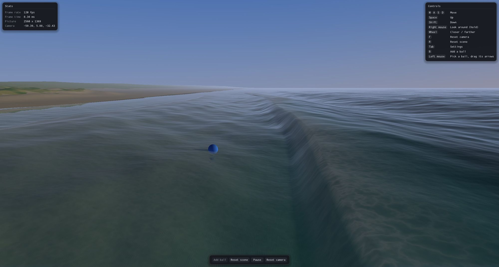

# Wotah



An endless beach by the sea, drawn with Vulkan: waves that build up, break and run up the sand, wet sand and lines of
foam where they reached, reflections and a view from under the water, a day and night cycle with sun, moon and stars,
and balls that float on the waves and get carried in by the surf. A project to learn realistic water waves.

## Download

Get the latest version from [Releases](../../releases): `Wotah-<version>-windows-x64.zip` holds `Wotah.exe`,
`Wotah-<version>-linux-x64.tar.gz` holds `wotah`. One file each, nothing to install. It needs a graphics card and
driver with Vulkan 1.3; on Linux also the Vulkan loader (`libvulkan1`) and a system about as new as Ubuntu 24.04.

## Controls

| Keys | What they do |
|---|---|
| W A S D | Move |
| Space / Shift | Up / down |
| Right mouse (hold) | Look around |
| Wheel | Closer / farther |
| F | Reset the camera |
| R | Reset the scene |
| Tab | Settings: time of day, light, waves, gravity, time speed, field of view |
| B | Add a ball |
| Left mouse | Pick a ball, then drag its arrows to move it |

## Building

You need CMake 3.24 or newer, a C++23 compiler (Visual Studio 2026, or GCC 14) and the
[Vulkan SDK](https://vulkan.lunarg.com/). The other libraries are fetched by CMake.

Windows:

```powershell
cmake --preset windows
cmake --build --preset windows-release
.\build\Release\square.exe
```

Linux:

```sh
cmake --preset linux-release
cmake --build --preset linux-release
./build/Release/square
```

The tests: `ctest --preset windows-debug` (or `linux-debug`, after building that preset).

What changed in each version: [CHANGELOG.md](CHANGELOG.md).
